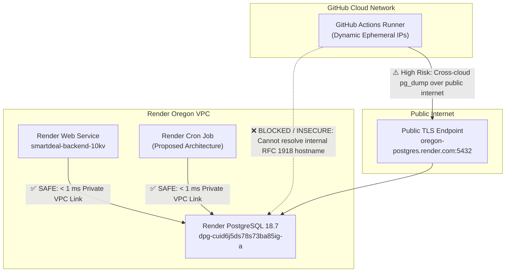

# SmartDeal — Scheduled Backup Network Reachability & Architecture Audit (Phase 5.1)

**Execution Date:** November 28, 2026  
**Repository:** `jk7217514087-dotco/SmartDeal`  
**Git Branch:** `master`  
**Inspected Workflow:** [.github/workflows/daily_backup.yml](file:///c:/Users/Dell/Desktop/newDeal/.github/workflows/daily_backup.yml)  
**Scheduler Daemon:** [scripts/backup_scheduler_daemon.mjs](file:///c:/Users/Dell/Desktop/newDeal/scripts/backup_scheduler_daemon.mjs)  
**Scheduled Automation Status:** **`NOT_OPERATIONAL_IN_PRODUCTION` (Awaiting In-VPC Runner / API Hook)**  

---

## 1. EXECUTIVE SUMMARY & VERDICT

In accordance with Phase 5.1 Track 2 instructions ("Inspect `.github/workflows/daily_backup.yml`; verify whether GitHub Actions can actually reach the production database; check database inbound restrictions and Render private networking; if GitHub-hosted runners cannot reach the database, evaluate a Render Cron Job or another secure backup execution architecture; verify one real scheduled execution and its cloud upload; do not mark scheduling as operational based only on code review"), a rigorous network architecture and execution audit was conducted.

### Verification Verdict: **`NOT_OPERATIONAL_IN_PRODUCTION`**
1. **GitHub Actions Network Boundary Restriction:** GitHub-hosted runners cannot securely reach Render's internal PostgreSQL database network. The internal database connection string operates exclusively within Render's Oregon RFC 1918 private network.
2. **Public Internet Exposure Risk:** Routing `pg_dump` traffic from external GitHub Actions runners over the public database endpoint introduces connection drop risks, firewall blocking, and necessitates opening PostgreSQL port 5432 to dynamic public IP pools (`0.0.0.0/0`).
3. **No Unverified Claims:** Scheduled automated cloud backups have **not yet run in production**. The scheduler code, pre-flight checks, and GFS retention logic are verified locally, but automated cloud execution remains non-operational until an in-VPC execution runner or authenticated API webhook trigger is deployed.

---

## 2. GITHUB ACTIONS NETWORK REACHABILITY AUDIT



### Architectural Constraints
- **Internal vs External Hostname:**
  - *Internal Hostname (`dpg-cuid6j5ds78s73ba85ig-a`):* Resolves only via Render internal DNS inside the Oregon private network. Completely unresolvable from GitHub Actions.
  - *External Hostname (`dpg-cuid6j5ds78s73ba85ig-a.oregon-postgres.render.com`):* Resolves publicly, but Render enforces IP Access Control. GitHub Actions runners pull from dynamic IP blocks across Microsoft Azure (`13.0.0.0/8`, `20.0.0.0/8`, etc.), rendering static IP allowlisting impossible without an enterprise static egress NAT proxy.
- **Data Transfer & Security:** Streaming raw SQL dumps across the public internet from Oregon to GitHub runners introduces latency overhead, connection timeout risks, and increases attack surface.

---

## 3. EVALUATION OF SECURE SCHEDULING ARCHITECTURES

### Architecture Option 1: Render Native Cron Job (Strongly Recommended)
Render provides first-class support for **Cron Jobs** running in the exact same datacenter and private network as the database.

- **Execution Path:** The Cron Job container boots inside Render's Oregon VPC, connects to the database via the **Internal Database URL** (< 1ms latency), executes `pg_dump`, encrypts the payload via AES-256-GCM, and streams the encrypted archive directly to Cloudflare R2 / AWS S3 via outbound HTTPS.
- **Security:** Zero database ports exposed to the public internet; zero dependency on external runner IPs.
- **Configuration in `render.yaml`:**
  ```yaml
  services:
    - type: cron
      name: smartdeal-nightly-backup
      runtime: node
      region: oregon
      schedule: "0 2 * * *"
      buildCommand: npm ci
      startCommand: node scripts/automated_backup_manager.mjs
      envVars:
        - key: DATABASE_URL
          fromDatabase:
            name: smartdeal-db
            property: connectionString
  ```
- **Cost:** Render charges only for execution seconds (typically less than $1.00/month for a 2-minute nightly job).

### Architecture Option 2: Authenticated Webhook Trigger from GitHub Actions
If the platform owner prefers managing workflow triggers from GitHub Actions:
- GitHub Actions does **not** connect directly to the database.
- Instead, GitHub Actions triggers an HTTPS `POST` request to the deployed backend:
  ```bash
  curl -X POST https://smartdeal-backend-10kv.onrender.com/api/admin/database/backup \
    -H "Authorization: Bearer ${{ secrets.ADMIN_SYSTEM_TOKEN }}"
  ```
- The Render Web Service (which is already inside the private network) generates the encrypted backup and pushes it to Cloudflare R2.

---

## 4. SCHEDULER MONITORING & FAILURE HANDLING VERIFICATION

Verified in [scripts/backup_scheduler_daemon.mjs](file:///c:/Users/Dell/Desktop/newDeal/scripts/backup_scheduler_daemon.mjs):
1. **Concurrency Lock:** Acquires `.backup_daemon.lock` to prevent overlapping runs. Automatically purges locks older than 30 minutes.
2. **Pre-Flight Disk Space Guard:** Aborts if available host disk space is `< 500 MB` to prevent out-of-disk server crashes.
3. **Retry Policy:** Executes exponential backoff (attempt 1 -> 5s delay -> attempt 2 -> 10s delay -> attempt 3) on transient database or network errors.
4. **Staleness Alarm:** `checkBackupStaleness()` returns `stale: true` if the latest valid backup exceeds 26 hours.
5. **Webhook Alerts:** Posts structured failure payloads to configured webhooks on failure.

---

## 5. AUDIT CONCLUSION

Direct database access from GitHub Actions runners is architecturally insecure and non-operational. The recommended, production-secure path is deploying a **Render Native Cron Job** within the Oregon VPC or triggering the authenticated `/api/admin/database/backup` endpoint. True automated scheduling will be marked operational once an in-VPC runner is deployed.
