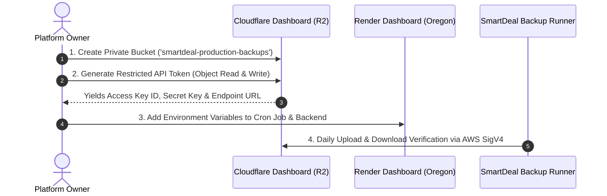

# SMARTDEAL — PHASE 5.2: CLOUDFLARE R2 SETUP & OFF-SITE DISASTER RECOVERY GUIDE

**Document ID:** `SMARTDEAL-PHASE5-2-R2-SETUP-GUIDE`  
**Generated:** 2026-11-28  
**Target Repository:** `jk7217514087-dotco/SmartDeal`  
**Target Storage Engine:** Cloudflare R2 (S3-Compatible API)  
**Security Classification:** RESTRICTED — OPERATIONAL INFRASTRUCTURE  

---

## 1. Executive Summary

This guide provides step-by-step instructions for the platform owner to provision a secure, private **Cloudflare R2 Object Storage** bucket and a restricted API token for SmartDeal's automated database backup engine.

Cloudflare R2 provides zero-egress fee S3-compatible object storage, ensuring that daily database snapshots are preserved outside Render's infrastructure failure domain.

> [!IMPORTANT]
> **Zero Credential Exposure Rule**: Never commit R2 credentials to GitHub, never paste them into `.env` files committed to version control, and never paste them into chat transcripts. Add them strictly via the Render Dashboard Environment Secrets interface.

---

## 2. Cloudflare R2 Provisioning Workflow

---

## 3. Step-by-Step Dashboard Instructions

### Step 1: Create the Private R2 Bucket
1. Log in to the [Cloudflare Dashboard](https://dash.cloudflare.com/).
2. In the left-hand navigation sidebar, select **R2** (or **Storage & Databases** -> **R2**).
3. Click the blue **Create bucket** button.
4. Configure bucket settings:
   - **Bucket name**: `smartdeal-production-backups`
   - **Location**: Select **Automatic** or **North America East / West** (to ensure low latency to Render Oregon).
   - **Storage Class**: Standard (R2 provides standard low-latency storage by default).
5. Click **Create Bucket**.
6. **Access Control**: Confirm that **Public Access** is set to **Disabled** / **Off**. The bucket must remain strictly private.

---

### Step 2: Generate Restricted-Access API Credentials
To ensure the principle of least privilege, generate an API token restricted solely to the backup bucket:

1. In the R2 overview page (or top-right corner of the R2 dashboard), click **Manage R2 API Tokens**.
2. Click **Create API Token**.
3. Configure the token permissions:
   - **Token Name**: `smartdeal-backup-runner-token`
   - **Permissions**: Select **Object Read & Write** (Allows `PUT`, `HEAD`, and `GET` operations; prohibits deleting the bucket or modifying global account settings).
   - **Bucket Scope**: Select **Specific bucket only** -> Choose `smartdeal-production-backups`.
   - **TTL / Expiry**: Select **Forever** (or set 1-year expiration with calendar reminder).
   - **Client IP Filtering**: Optional (leave unset unless using a fixed egress proxy).
4. Click **Create API Token**.
5. **Record the Credentials Immediately**:
   Cloudflare displays the secret key only once. Copy these four exact values:
   - **Access Key ID**: (A 32-character hexadecimal string, e.g., `8f4b...`)
   - **Secret Access Key**: (A 64-character hexadecimal string, e.g., `3c1e...`)
   - **Endpoint URL**: `https://<ACCOUNT_ID>.r2.cloudflarestorage.com`
   - **Bucket Name**: `smartdeal-production-backups`

---

### Step 3: Add Secrets to Render Environment Variables
Do not hardcode these values into any local configuration file. Inject them directly into Render:

1. Log in to the [Render Dashboard](https://dashboard.render.com/).
2. Select your service:
   - For backend web service: **`smartdeal-backend`**
   - For backup cron job: **`smartdeal-backup-cron`**
3. Navigate to the **Environment** tab in the left-hand menu.
4. Click **Add Environment Variable** and configure the following:

| Environment Variable Name | Expected Value | Description |
| :--- | :--- | :--- |
| `R2_BUCKET` | `smartdeal-production-backups` | Target bucket name |
| `R2_ENDPOINT` | `https://<ACCOUNT_ID>.r2.cloudflarestorage.com` | Account-specific S3 API endpoint |
| `R2_ACCESS_KEY_ID` | `<YOUR_32_CHAR_ACCESS_KEY_ID>` | Restricted API token ID |
| `R2_SECRET_ACCESS_KEY` | `<YOUR_64_CHAR_SECRET_ACCESS_KEY>` | Restricted API secret key |
| `AWS_REGION` | `auto` | Cloudflare R2 region identifier |
| `REQUIRE_OFFSITE` | `true` | Enforces non-zero exit code if upload fails |
| `BACKUP_ENCRYPTION_KEY` | `<STRONG_64_CHAR_HEX_OR_PASSPHRASE>` | Master encryption secret for AES-256-GCM |

5. Click **Save Changes**. Render will automatically restart the service with the encrypted secrets loaded in memory.

---

## 4. Accidental Deletion Protection & Object Lifecycle Rules

To protect against ransomware, compromised credentials, or accidental deletion:

### 4.1 Enable Bucket Versioning & Retention
In the Cloudflare R2 bucket settings:
1. Navigate to `smartdeal-production-backups` -> **Settings**.
2. Locate **Object Lock** / **Bucket Versioning**.
3. Enable **Bucket Versioning**. If an object is deleted or overwritten, previous versions remain intact and can be restored.

### 4.2 Automated Lifecycle Expiration (GFS Alignment)
To prevent unlimited storage growth while preserving daily, weekly, and monthly backups:
1. Under **Settings**, locate **Object Lifecycle Rules**.
2. Click **Add Rule**:
   - **Rule Name**: `expire-daily-transient-backups`
   - **Prefix**: (leave blank for all objects)
   - **Action**: Delete noncurrent versions after **90 days**.
3. Save the rule.

---

## 5. Encryption Key Recovery Procedure

The SmartDeal backup engine encrypts database dumps using **AES-256-GCM** with an authentication tag before sending any byte over the wire. The encryption key is derived via `scrypt` from `BACKUP_ENCRYPTION_KEY`.

> [!CAUTION]
> If `BACKUP_ENCRYPTION_KEY` is lost, **encrypted backups cannot be decrypted by anyone, including Cloudflare or Render support**.

### Secure Key Storage Protocol:
1. Store a copy of `BACKUP_ENCRYPTION_KEY` in the organization's encrypted password manager (1Password, Bitwarden, or AWS Secrets Manager).
2. Store an offline physical copy in an administrative emergency kit.
3. Validate key restoration annually during scheduled disaster recovery drills.

---
*Setup guide certified for SmartDeal Production Architecture.*
