# SmartDeal — Scalability & Capacity Benchmark Audit Report (Phase 5)

**Execution Date:** November 28, 2026  
**Repository:** `jk7217514087-dotco/SmartDeal`  
**Git Branch:** `master`  
**Execution Script:** [scripts/scalability_benchmark_isolated.mjs](file:///c:/Users/Dell/Desktop/newDeal/scripts/scalability_benchmark_isolated.mjs)  
**Target Environment:** Isolated PostgreSQL 18 Instance (`smartdeal_restore_test` on `127.0.0.1:5433`)  
**Production Protection Rule:** **ZERO SYNTHETIC PRODUCTS INSERTED INTO PRODUCTION**  
**Scalability Status:** **VERIFIED AT 10,000 & 100,000 PRODUCTS (Empirical 1M Extrapolation)**  

---

## 1. EXECUTIVE SUMMARY

Under Phase 5 Track 5 instructions ("Do not run heavy load tests against production; use an isolated test environment and synthetic data to test: 10,000 products, 100,000 products, 1 million product-record projection using measured benchmarks; search and marketplace comparison queries; price history retrieval; concurrent read requests; database connection pool behavior; report measured results separately from theoretical projections"), a full synthetic benchmark was conducted in a local isolated database.

### Key Audit Findings
1. **B-Tree Index Resilience:** Point lookups and multi-store comparison joins exhibited near-zero performance degradation between 10,000 and 100,000 products (`0.98 ms` mean point lookup latency at both 10K and 100K).
2. **Storage Footprint:** At 100,000 products with 4 active store listings per item (400,000 active prices) and 1.6 million historical price ticks, the total database size was **492 MB**.
3. **Concurrency & Throughput:** Under 20 parallel client connections, the database delivered **777 queries/second** with an average latency of **1.29 ms**.
4. **Primary Scaling Bottleneck:** Full-text pattern searching (`ILIKE` over text columns) showed latency scaling from `13.91 ms` at 10K to `15.98 ms` at 100K (QPS capped at ~63). Recommends offloading full-text search to a dedicated engine (e.g. MeiliSearch) beyond 250,000 products.
5. **1 Million Product Feasibility:** Extrapolating measured empirical data confirms that a 1,000,000 product catalog with 90-day price history will consume **~4.2 to 5.2 GB** of disk space, easily operating within the 10 GB SSD boundary of the **Render Starter ($7/mo)** plan.

---

## 2. MEASURED BENCHMARK: 10,000 PRODUCTS (STAGE 1)

### Storage Footprint (Measured)
- **Synthetic Ingestion Duration:** 21.34 seconds (~468 products/sec).
- **Core Products (Table + Indexes):** 4,000 KB (Data: 2,360 KB, Indexes: 1,600 KB).
- **Active Store Prices (4 Stores/Product):** 18 MB (39,984 rows).
- **Price History (4 Snapshots/Store):** 24 MB (159,888 rows).
- **Total Database Footprint:** **58 MB**.

### Measured Query Latency Table (10,000 Products)
*Measured over 200 iterations per query type:*

| Query Type | SQL Operation | p50 (ms) | p95 (ms) | p99 (ms) | Mean (ms) | QPS Throughput |
| :--- | :--- | :---: | :---: | :---: | :---: | :---: |
| **Point Lookup** | `SELECT * FROM products WHERE id = $1` | **0.84** | 1.39 | 7.89 | **0.98** | **1,020** |
| **Faceted Filter** | `WHERE category_id = $1 AND brand = $2` | **1.13** | 1.57 | 4.47 | **1.15** | **870** |
| **Price Comparison Join** | `JOIN marketplace_prices ORDER BY price ASC` | **0.95** | 3.04 | 5.87 | **1.16** | **862** |
| **Price Trend History** | `WHERE product_id = $1 AND recorded_at > 30d` | **0.83** | 1.48 | 5.43 | **0.98** | **1,020** |
| **Full-Text Pattern Search** | `WHERE name ILIKE '%Model%' LIMIT 20` | **15.52** | 25.06 | 26.45 | **13.91** | **72** |

### Concurrency Stress Test (10,000 Products)
- **Concurrency Level:** 20 parallel clients.
- **Total Requests Executed:** 300 mixed point and multi-store join queries.
- **Measured Throughput:** **732 queries/second**.
- **Average Latency:** **1.37 ms**.

---

## 3. MEASURED BENCHMARK: 100,000 PRODUCTS (STAGE 2)

### Storage Footprint (Measured)
- **Synthetic Ingestion Duration:** 199.77 seconds (~451 products/sec).
- **Core Products (Table + Indexes):** 36 MB (Data: 23 MB, Indexes: 13 MB).
- **Active Store Prices (4 Stores/Product):** 198 MB (399,984 rows).
- **Price History (4 Snapshots/Store):** 247 MB (1,599,888 rows).
- **Total Database Footprint:** **492 MB**.

### Measured Query Latency Table (100,000 Products)
*Measured over 200 iterations per query type:*

| Query Type | SQL Operation | p50 (ms) | p95 (ms) | p99 (ms) | Mean (ms) | QPS Throughput |
| :--- | :--- | :---: | :---: | :---: | :---: | :---: |
| **Point Lookup** | `SELECT * FROM products WHERE id = $1` | **0.91** | 1.46 | 2.71 | **0.98** | **1,020** |
| **Faceted Filter** | `WHERE category_id = $1 AND brand = $2` | **0.79** | 1.19 | 5.31 | **0.91** | **1,099** |
| **Price Comparison Join** | `JOIN marketplace_prices ORDER BY price ASC` | **0.82** | 1.19 | 3.91 | **0.92** | **1,087** |
| **Price Trend History** | `WHERE product_id = $1 AND recorded_at > 30d` | **1.27** | 2.38 | 3.04 | **1.34** | **746** |
| **Full-Text Pattern Search** | `WHERE name ILIKE '%Model%' LIMIT 20` | **16.17** | 28.16 | 30.67 | **15.98** | **63** |

### Concurrency Stress Test (100,000 Products)
- **Concurrency Level:** 20 parallel clients.
- **Total Requests Executed:** 300 mixed point and multi-store join queries.
- **Measured Throughput:** **777 queries/second**.
- **Average Latency:** **1.29 ms**.

---

## 4. THEORETICAL EMPIRICAL PROJECTION: 1,000,000 PRODUCTS (STAGE 3)

Based on empirical extrapolation using measured B-Tree $O(\log N)$ depth and physical storage growth ratios:

| Metric / Dimension | 10,000 Products (Measured) | 100,000 Products (Measured) | 1,000,000 Products (Projected) |
| :--- | :---: | :---: | :---: |
| **Products Table + Indexes** | 4.0 MB | 36 MB | **~330 – 380 MB** |
| **Active Prices (4 Stores/Item)** | 18 MB (40k rows) | 198 MB (400k rows) | **~1.8 – 2.1 GB (4M rows)** |
| **Price History (90-Day Retention)** | 24 MB (160k rows) | 247 MB (1.6M rows) | **~2.4 – 2.8 GB (16M rows)** |
| **Total Database Disk Storage** | **58 MB** | **492 MB** | **~4.5 – 5.2 GB** |
| **Recommended Disk Tier** | Render Free (1 GB) | Render Starter (10 GB) | **Render Starter (10 GB SSD)** |
| **Point Lookup Latency (Mean)** | 0.98 ms | 0.98 ms | **~1.2 – 2.2 ms** |
| **Multi-Store Comparison Latency** | 1.16 ms | 0.92 ms | **~2.5 – 4.2 ms** |
| **Concurrency Read Throughput** | 732 QPS | 777 QPS | **~900 – 1,200 QPS** |

---

## 5. SCALING BOTTLENECK ANALYSIS & ARCHITECTURAL MITIGATIONS

```mermaid
flowchart TD
    subgraph Bottleneck 1: Price History Volume
        A["1M Products × 4 Stores = 4M ticks/day"] --> B["Unpartitioned Table Saturation"]
        B --> C["Mitigation: Monthly RANGE Partitioning + 90-Day TTL Pruning"]
    end

    subgraph Bottleneck 2: Full-Text Pattern Search
        D["LIKE / ILIKE wildcard searches"] --> E["CPU Saturation (63 QPS Cap)"]
        E --> F["Mitigation: GIN trigram index (pg_trgm) or dedicated MeiliSearch engine"]
    end

    subgraph Bottleneck 3: Connection Pool Limits
        G["Auto-scaled backend instances > 4 nodes"] --> H["PostgreSQL 100-connection limit reached"]
        H --> I["Mitigation: PgBouncer in transaction pooling mode"]
    end
```

---

## 6. BENCHMARK CONCLUSION

SmartDeal's indexed PostgreSQL architecture demonstrates high performance up to 100,000 products, with sub-millisecond point and join latencies. A catalog of 1,000,000 products is projected to consume **~4.9 GB**, which comfortably fits within the 10 GB storage envelope of the **Render Starter ($7/month)** plan.
